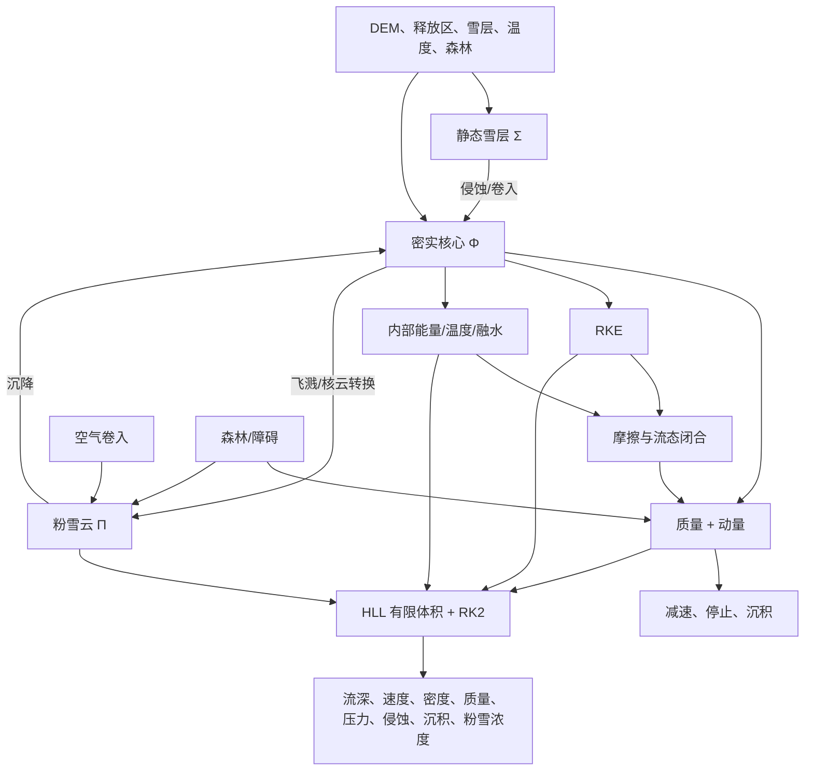
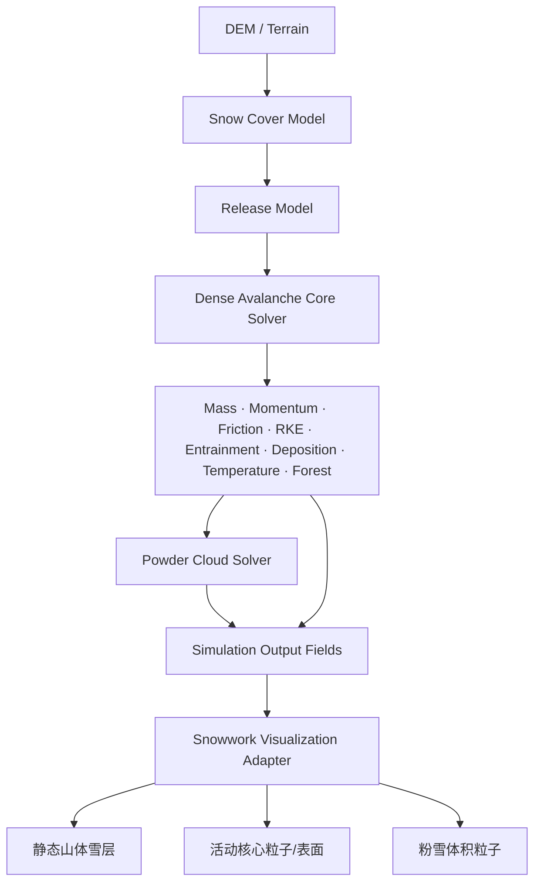
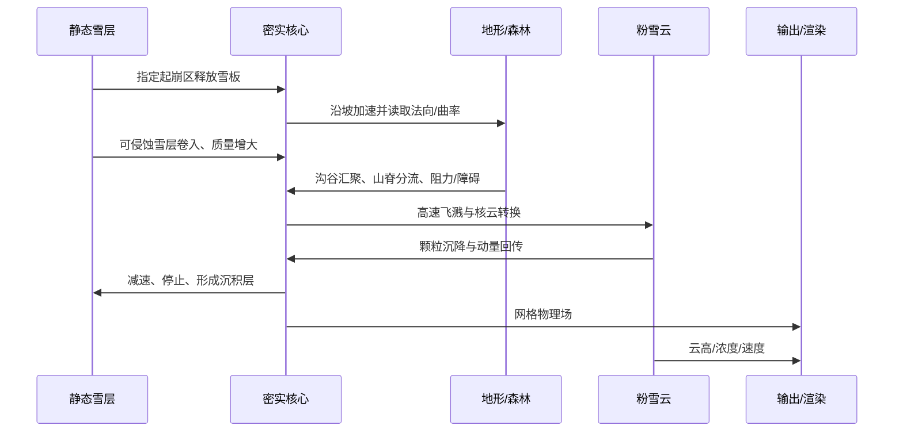

# RAMMS::Extended 公开实现原理拆解

> 用途：为 Snowwork 3D 的开放雪崩物理仿真求解器提供原理、复用边界与实施路线。  
> 版本：2026-11-17，第一阶段研究与设计稿。  
> 范围：仅使用公开论文、官方技术网页/手册、公开演示资料、AvaFrame 本地开源代码和 OpenFOAM-avalanche 公开源码。未对 RAMMS 可执行程序进行逆向、反编译、动态探测或破解。本报告未修改 Snowwork、AvaFrame 或 OpenFOAM 的项目代码。

## 0. 核心结论

1. **RAMMS::Extended 是多相、深度平均、能量一致的雪崩模型族。**公开资料显示，它至少耦合密实核心、粉雪云、飞溅/前缘、可侵蚀雪层、空气和森林，并对质量、动量、随机动能（RKE）与内部能量进行平衡。[R1][R7][R8]
2. **公开资料足以复现“同一物理思想”的开放求解器，但不足以声明与商业程序逐项数值等价。**守恒方程、HLL 有限体积框架、RKE/内能主方程、部分侵蚀与粉雪方程均已公开；当前产品中若干闭合关系、参数分区规则、核—云转换细节、树木破坏和湿雪相变实现仍无法由公开资料完整确认。
3. **AvaFrame `com1DFA` 是将军山密实流 MVP 的最佳基线和交叉验证对象。**它已经具备复杂 DEM、密实流、Voellmy 类摩擦、空间侵蚀层、质量/动量更新、停止与阻力项；缺少可直接运行的 RKE—温度—粉雪双层链路。[A1][A2][A3]
4. **OpenFOAM-avalanche 是粉雪云和双层耦合最有价值的公开参考。**其 `faSavageHutterFoam`、`faParkerFukushimaFoam`、`faTwoLayerAvalancheFoam` 分别覆盖密实流、悬浮流和双层混合流，并公开了侵蚀、沉降、空气卷入和层间质量/动量交换思想。[O1][O2]
5. **推荐新建独立 Snowwork Avalanche Solver。**第一版采用规则投影 DEM 上的二维深度平均有限体积求解器，先完成密实流、质量/动量、Voellmy、空间雪层侵蚀与沉积；随后增加 RKE、内部能量、森林、粉雪云和双层交换。AvaFrame 用于基线对照，OpenFOAM 用于粉雪方程与验证参考。
6. **物理场与三维渲染必须通过标准化输出文件解耦。**求解器输出网格场；Snowwork 只读取活动区，按速度、流深、密度和粉雪浓度生成 GPU 粒子。未发生运动的山体始终使用静态雪层。

## 1. 证据等级与术语

| 标记 | 含义 |
|---|---|
| A | RAMMS 官方网页、官方应用指南或官方公开方程 |
| B | 同一研究团队的同行评议论文/公开会议资料 |
| C | 可审计的开源实现或其同行评议论文 |
| U | 公开资料无法确认；不能假定与 RAMMS 产品内部实现相同 |

主要符号：`h` 为流深（m），`u=(u_x,u_y)` 为表面切向深度平均速度（m/s），`ρ` 为密度（kg/m³），`g_s` 为沿坡重力分量（m/s²），`g_n` 为法向重力分量（m/s²），`N` 为底面法向应力（Pa），`R` 为随机动能状态量，`E` 为内部能量，`Σ/Φ/Π` 分别表示静态雪层、密实核心、粉雪云。不同论文对 `R` 使用“单位质量能量”或“深度积分能量”约定；实现时必须固定量纲，不能混用参数。

## 2. RAMMS::Extended 公开技术架构图



官方概述把 Extended 的主要成分列为密实核心、粉雪云、飞溅前缘、雪盖、空气与森林；Zhuang 等和 Glaus 等公开了对应的深度平均守恒方程。[R1][R7][R8]

## 3. RAMMS 核心方程整理

### 3.1 密实核心质量守恒

RAMMS 官方基础形式为：

$$
\frac{\partial H}{\partial t}+\nabla_s\cdot(H\mathbf{u})=\dot Q,
$$

其中 `Q̇` 汇总释放、侵蚀卷入、沉积和核—云转换引起的单位面积体积源项（m/s）。Extended 的公开多相形式进一步区分静态雪层、核心和粉雪相，并引入密度/共体积修正。[R2][R7]

工程实现建议采用质量面密度 `m=ρh`：

$$
\frac{\partial m_\Phi}{\partial t}+\nabla_s\cdot(m_\Phi\mathbf{u}_\Phi)
=\dot m_{\Sigma\rightarrow\Phi}-\dot m_{\Phi\rightarrow\Sigma}-\dot m_{\Phi\rightarrow\Pi}.
$$

### 3.2 密实核心动量守恒

二维表面坐标中的保守形式可写为：

$$
\frac{\partial (m\mathbf u)}{\partial t}
+\nabla_s\cdot\left(m\mathbf u\otimes\mathbf u+\frac12 k\rho g_n h^2\mathbf I\right)
=m\mathbf g_s-\boldsymbol\tau_b+\mathbf S_{ent}+\mathbf S_{dep}+\mathbf S_{forest}+\mathbf S_{exchange}.
$$

`k` 是主动/被动土压力系数或等效侧压力系数。RAMMS 官方数值文档公开了 `H,HUx,HUy,HR` 的守恒变量组织和重力、摩擦、RKE 生产/耗散源项；Extended 论文补充了侵蚀、飞溅、树木和核—云交换项。[R3][R7]

### 3.3 Voellmy—Salm / 扩展摩擦

基础底面阻力：

$$
\tau_b=\mu N+\frac{\rho g}{\xi}|\mathbf u|^2,
\qquad N\approx\rho g_n h.
$$

带最小剪切/黏聚修正的官方公开形式：

$$
\tau_b=\mu N+\frac{\rho g}{\xi}|\mathbf u|^2
+(1-\mu)N_0\left(1-e^{-N/N_0}\right).
$$

方向与 `u` 相反。Extended 论文把 `μ` 与 `ξ` 写成 RKE、温度和融水的函数；常见公开表达为 `μ=μ0 exp(-R/R0)`、`ξ=ξ0 exp(+R/R0)`，但当前商业版本使用的完整函数与限幅规则公开资料无法确认。[R4][R6][R7]

### 3.4 随机动能 RKE

简化输运方程：

$$
\frac{\partial(hR)}{\partial t}+\nabla_s\cdot(hR\mathbf u)
=\alpha\,\dot W_f+\varepsilon\,\dot W_{ent}-\beta hR-R\dot m_{out}/\rho.
$$

`Ẇ_f=τ_b·u` 为摩擦功率，`α` 为转入随机运动的比例，`β` 为耗散率（s⁻¹），`ε` 为侵蚀碰撞能分配比例。RKE 增大通常降低有效库仑摩擦并增大湍流阻力尺度，使高速流更具流动性；RKE 衰减转化为内部热。[R5][R6][R7][R8]

公开温度相关耗散示例：

$$
\beta_\Phi(T)=1.40+\frac{1.6}{\pi}\arctan[1.6(T-271.5\,K)],
$$

约束于 `0.6–2.0 s⁻¹`。[R8]

### 3.5 内部能量、温度与融水

公开论文中的结构形式为：

$$
\frac{\partial(hE)}{\partial t}+\nabla_s\cdot(hE\mathbf u)
=(1-\alpha)\dot W_f+\beta hR+(1-\varepsilon)\dot W_{ent}
+\dot m_{ent}c_sT_s-E\dot m_{out}-\dot Q_m.
$$

内部能量接收未转入 RKE 的摩擦功、RKE 衰减和部分侵蚀功；达到相变条件后以潜热生成融水，融水再反馈摩擦。RAMMS 官方说明模型中的融化通常在平均温度接近约 `−2 °C` 后开始显著，但完整焓—融水闭合、数值限幅和产品版本差异公开资料无法确认。[R7][R9]

### 3.6 雪层侵蚀与卷入

公开 Extended 论文给出一种坡面侵蚀系数：

$$
\kappa=\frac{\kappa'}{g}(g_s-\mu_b g_n),\qquad \kappa\ge 0,
$$

并把受影响雪层分配到核心和飞溅/粉雪通道。公开案例使用 `κ′≈0.015`；官方应用指南以雪层屈服强度控制可侵蚀性，推荐起始量级 `300 Pa`。精确侵蚀速率、前缘飞溅和悬崖放大项在商业实现中的组合公开资料无法完整确认。[R8][R10]

### 3.7 粉雪云质量、动量与湍动能

公开模型至少包含：

$$
\partial_t(\rho_\Pi h_\Pi)+\nabla_s\cdot(\rho_\Pi h_\Pi\mathbf u_\Pi)
=\dot m_{\Phi\to\Pi}-\dot m_{settle}+\rho_a\dot h_{air},
$$

$$
\partial_t(\rho_\Pi h_\Pi\mathbf u_\Pi)+\nabla_s\cdot(\rho_\Pi h_\Pi\mathbf u_\Pi\otimes\mathbf u_\Pi+p_\Pi\mathbf I)
=\mathbf F_{buoyancy}-\mathbf F_{drag}+\mathbf S_{exchange}+\mathbf S_{air},
$$

并有粉雪湍动能的生产、输运和 `βΠ` 衰减方程。云体密度由雪粒和空气混合决定；公开示例使用冰密度约 `971 kg/m³`、空气密度约 `1.225 kg/m³`。[R7][R8]

### 3.8 数值离散

RAMMS 官方公开的数值骨架：

- DEM 生成嵌入三维空间的二维四边形表面控制体；
- 单元中心有限体积；
- 线性重构 + Minmod 限制器；
- HLL 近似 Riemann 通量，干湿界面采用 Toro 型波速估计；
- 正性保持处理，避免负流深/负能量；
- 二阶 Heun / RK2 时间推进，动态 CFL 控制；
- 两排 ghost cells 处理边界；
- 官方测试中带限制器经验收敛阶约 `1.67`。[R3]

当前公开资料没有给出全部边界类型、每个源项的离散次序、所有湿干修正与 GPU/CPU 并行实现细节。

## 4. 核心模块逐项拆解

难度和重要度均采用 1–5 级：5 为最高。参数范围只表示文献/指南中的校准起点，不能脱离事件和分辨率直接照搬。

### 4.1 Dense Avalanche Core：密实雪崩主体

| 项目 | 内容 |
|---|---|
| 物理意义 | 把雪崩主体视为沿复杂地形运动的浅层、可压缩/可扩散颗粒—雪团连续体，承担主要质量、冲击和堆积。 |
| 输入变量 | DEM/表面网格、释放厚度、初始密度与温度、雪层、摩擦分区、森林/障碍、重力。 |
| 状态变量 | `hΦ [m]`、`mΦ=ρΦhΦ [kg/m²]`、`uΦ [m/s]`、RKE、内部能量/温度；Extended 还公开了共体积/分散高度变量。 |
| 输出变量 | 流深、速度、密度、质量、动量、动压/冲击压、活动范围与停止位置。 |
| 控制方程 | 深度平均质量、二维切向动量、RKE、内部能量及相间源项，见 3.1–3.5。 |
| 关键参数与单位 | `ρΦ [kg/m³]`、侧压力系数 `k [-]`、`μ [-]`、`ξ [m/s²]`、RKE/能量参数。 |
| 典型值/范围 | 官方干雪指南的松散新雪密度常为 `150–225 kg/m³`；释放厚度常见 `0.8–1.6 m`，极端可接近 `2 m`；释放坡度约 `28–55°`。[R10] |
| 数据依赖 | 接收释放、雪层侵蚀、摩擦、能量、森林与粉雪交换；向沉积、粉雪与输出模块提供核心状态。 |
| 公开程度/代码 | 主方程已公开（A/B）；RAMMS 完整闭合 U。AvaFrame `com1DFA` 和 OpenFOAM `faSavageHutterFoam` 可参考（C）。 |
| 难度 / 将军山重要度 | `5 / 5`。这是求解器主干。 |

### 4.2 Mass Conservation：质量守恒

| 项目 | 内容 |
|---|---|
| 物理意义 | 保证释放质量、卷入质量、沉积质量、核云交换质量与域外流出闭合。 |
| 输入/状态/输出 | 输入各质量通量；状态 `mΦ,mΠ,mΣ [kg/m²]`；输出各相质量、累计卷入/沉积与质量残差。 |
| 控制方程 | `∂tm+∇·(mu)=Σṁin−Σṁout`。密实、粉雪、静态层分别记账，层间通量必须等量反号。 |
| 参数与范围 | 无经验主参数；数值阈值 `h_min [m]`、密度、边界通量需要配置。 |
| 数据依赖 | 所有侵蚀、沉积、粉雪和边界模块；质量源必须同步传入动量与能量。 |
| 公开程度/代码 | 公式完全公开（A/B）；AvaFrame 与 OpenFOAM 均有守恒实现（C）。 |
| 难度 / 重要度 | `3 / 5`。方程简单，干湿界面、相间一致性和地形面积度量决定实际难度。 |

### 4.3 Momentum Conservation：动量守恒

| 项目 | 内容 |
|---|---|
| 物理意义 | 决定沿坡加速、转弯、沟谷汇聚、山脊分流、冲击和停止。 |
| 输入变量 | 质量/流深、地形法向与曲率、速度、压力、摩擦、侵蚀/沉积速度、森林/障碍、层间通量。 |
| 状态/输出 | `m u_x,m u_y [kg/(m·s)]`；输出速度矢量、动量通量、冲击压力。 |
| 控制方程 | 3.2 的表面浅水/颗粒动量方程；质量交换同时带走或带入相应动量。 |
| 关键参数 | `k [-]`、重力 `9.81 m/s²`、速度形状因子、曲率修正、各源项系数。 |
| 数据依赖 | 地形、摩擦、RKE、温度、侵蚀、沉积、森林和粉雪；向所有后续模块输出速度。 |
| 公开程度/代码 | 主方程公开（A/B）；具体源项次序和当前 RAMMS 限幅 U。两套开源代码可参考（C）。 |
| 难度 / 重要度 | `5 / 5`。将军山沟谷/山脊响应直接依赖三维表面几何与动量投影。 |

### 4.4 Random Kinetic Energy / RKE

| 项目 | 内容 |
|---|---|
| 物理意义 | 表示雪块碰撞、颗粒搅动和垂向随机运动形成的“机械温度”，调节有效摩擦、扩散和由高速流向停止态的转换。 |
| 输入变量 | 摩擦功、侵蚀碰撞功、温度、质量交换。 |
| 状态/输出 | `R [J/kg]` 或论文定义的深度积分量；输出摩擦修正、耗散热和可供粉雪形成的能量。 |
| 控制方程 | `∂t(hR)+∇·(hRu)=αẆf+εẆent−βhR−exchange`。 |
| 参数与单位 | `α,ε [-]`，`β [s⁻¹]`，`R0` 与 `R` 同量纲。 |
| 典型值/范围 | 2026 官方应用指南将 GUI 中 Generate 建议约 `5–8%`；公开研究中的 `β` 干雪约 `0.65 s⁻¹`、湿雪约 `1.25 s⁻¹`，较新温度函数覆盖约 `0.6–2.0 s⁻¹`。这些值来自不同模型代际，需分开校准。[R5][R8][R10] |
| 数据依赖 | 从摩擦/侵蚀取功率，向摩擦和内能反馈，并可向粉雪云传递。 |
| 公开程度/代码 | 方程公开（B）；当前 RAMMS 的全部闭合和 `R0` 产品参数 U。AvaFrame `com1DFA` 无 RKE；OpenFOAM 双层模型使用另一套湍动能思想。 |
| 难度 / 重要度 | `4 / 4`。MVP 可暂缓，第二阶段应加入以改善速度—停止—堆积连续性。 |

### 4.5 Snow Entrainment：沿途雪层侵蚀与卷入

| 项目 | 内容 |
|---|---|
| 物理意义 | 活动雪崩克服静态雪层强度并卷雪增容，显著改变质量、速度、流深和粉雪潜力。 |
| 输入变量 | 静态雪层厚度/密度/温度、屈服强度、核心速度与剪切功、坡度、森林掩膜。 |
| 状态/输出 | `hΣ [m]`、累计侵蚀深度、`ṁΣ→Φ [kg/(m²s)]`、可能的飞溅/云质量。 |
| 控制方程 | Extended 公开 `κ=(κ′/g)(gs−μbgn)` 类关系及核心/飞溅分配；OpenFOAM 还公开能量侵蚀 `S=(τ·u)/(ρ eb) φ`。[R8][O2] |
| 参数与单位 | `κ′ [-]`、底层摩擦 `μb [-]`、屈服强度 `τy [Pa]`、侵蚀能 `eb [J/kg]`、雪层深度/密度。 |
| 典型值/范围 | Extended 公开案例 `κ′≈0.015`；官方推荐雪层屈服强度起点 `300 Pa`；新雪密度 `150–225 kg/m³`；高度梯度示例常约 `0.05 m/100 m`。[R8][R10] |
| 数据依赖 | 读取 Snow Cover，写入核心质量/动量/RKE/内能，耗减静态雪层。 |
| 公开程度/代码 | 主思想和部分公式公开（A/B）；商业版完整碰撞/飞溅闭合 U。AvaFrame `computeEntMassAndForce` 与 OpenFOAM `src/avalanche/entrainment/` 可参考（C）。 |
| 难度 / 重要度 | `4 / 5`。将军山必须使用空间雪层，不能使用全域常数厚度。 |

### 4.6 Deposition：减速与堆积

| 项目 | 内容 |
|---|---|
| 物理意义 | 当驱动力不足、RKE 衰减或材料进入缓坡时，流动物质转入静态堆积层，并改变后续地形/雪面。 |
| 输入变量 | 核心速度、流深、RKE、温度、底面应力、坡度、静态层容量。 |
| 状态/输出 | `ṁΦ→Σ [kg/(m²s)]`、沉积厚度、最终堆积范围、停止时间。 |
| 控制方程 | 质量与动量源汇必须一致；RAMMS Extended 的能量/共体积框架支持流态向沉积转换。仅靠经典 Voellmy 停止阈值无法完整描述沉积。[R7][R11] |
| 参数与单位 | 停止/屈服阈值 `[Pa]`、最小速度 `[m/s]`、沉积密度 `[kg/m³]`、RKE 阈值 `[J/kg]`（具体产品闭合 U）。 |
| 典型值/范围 | RAMMS 当前完整沉积参数公开范围不足；不得从界面现象反推内部公式。 |
| 数据依赖 | 读取动量/RKE/温度，回写静态层和质量守恒，并生成最终 DEM 上的沉积场。 |
| 公开程度/代码 | 物理框架 B，当前产品完整闭合 U。AvaFrame 有停止粒子/可选表面更新；OpenFOAM 有 `src/avalanche/deposition/depositionModel` 和 Rauter–Köhler 模型（C）。 |
| 难度 / 重要度 | `4 / 5`。最终堆积位置是系统验收的核心结果。 |

### 4.7 Temperature / Internal Energy

| 项目 | 内容 |
|---|---|
| 物理意义 | 跟踪摩擦生热、侵蚀冷雪混合、RKE 衰减和融雪潜热；温度/融水会改变摩擦、侵蚀和流态。 |
| 输入变量 | 初始核心与雪层温度、摩擦功、RKE、卷入质量温度、热容、潜热。 |
| 状态/输出 | `E [J/kg]`、`T [K 或 °C]`、融水率/含水量，输出温度修正后的 `μ,ξ,β`。 |
| 控制方程 | 3.5 内能方程与焓—温度—融水关系。 |
| 参数与单位 | 冰/雪比热 `cp [J/(kg·K)]`、融化潜热 `Lm [J/kg]`、初温、温度梯度 `[K/100m]`。 |
| 典型值/范围 | 官方干雪指南常用初始雪温约 `−9 至 −3.5 °C`、高程梯度约 `0.3 °C/100m`；模型说明中融水影响常在平均温度约 `−2 °C` 附近开始显著。[R9][R10] |
| 数据依赖 | 接收摩擦/RKE/侵蚀功，反馈摩擦、RKE 衰减、侵蚀和粉雪形成。 |
| 公开程度/代码 | 主方程公开（A/B），完整相变闭合 U。AvaFrame `wetSnow` 是实验性焓相关摩擦，不能视为完整 Extended 热力学；OpenFOAM-avalanche 无等价模块。 |
| 难度 / 重要度 | `4 / 3`（MVP）；对干粉雪与湿雪跨情景提升到 `4–5`。 |

### 4.8 Friction Model：库仑、速度平方与其他阻力

| 项目 | 内容 |
|---|---|
| 物理意义 | 底面库仑项控制低速/停止，速度平方项控制高速稳态速度，黏聚项支持低法向应力和小雪崩。 |
| 输入变量 | `N,ρ,h,u,R,T,` 融水、地表分类。 |
| 状态/输出 | 可无独立状态；输出底面剪应力矢量和摩擦功率。 |
| 控制方程 | 3.3；可叠加 `N0` 黏聚/最小剪切项与空间参数栅格。 |
| 参数与单位 | `μ [-]`、`ξ [m/s²]`、`N0 [Pa]`，RKE/温度修正参数。 |
| 典型值/范围 | 2026 干雪应用指南的六类起始值：`μ0≈0.30–0.55`，`ξ0≈1800–2000 m/s²`，`N0≈50–200 Pa`。早期 RKE 论文常见 `ξ0≈500–700 m/s²`，属于不同代际/标定，不能混用。[R5][R10] |
| 数据依赖 | 从核心和能量读取状态，向动量、RKE和内能提供剪应力/功率。 |
| 公开程度/代码 | 基础公式公开（A/B）；当前产品完整映射 U。AvaFrame/OpenFOAM 均有可审计实现（C）。 |
| 难度 / 重要度 | `3 / 5`。MVP 必须实现空间参数和低速不反向的半隐式处理。 |

### 4.9 Powder Cloud：粉雪云

| 项目 | 内容 |
|---|---|
| 物理意义 | 雪粒悬浮于空气形成低密度、高速、可超越密实前缘的重力流，决定可见云团和远程冲击。 |
| 输入变量 | 核心抛雪质量/动量/RKE、空气密度、地形、风（若建模）、粒径、沉降速度、空气卷入。 |
| 状态/输出 | 云高、混合密度、雪浓度、速度、湍动能；输出粉雪范围、浓度和动压。 |
| 控制方程 | 3.7 的变密度悬浮层质量、动量、体积和湍动能方程。 |
| 参数与单位 | 云体阻力、空气卷入系数、`βΠ [s⁻¹]`、粒径 `[m]`、沉降速度 `[m/s]`。 |
| 典型值/范围 | 官方应用指南 GUI 起点：Cloud drag `2–4`（3 常用）、Powder beta `1–3`（2 常用）、Air entrainment `2`；这些是 RAMMS 标定系数，量纲/与经典 `Cd` 的一一关系公开资料无法确认。[R10] |
| 数据依赖 | 读取核心转换通量和空气卷入，向核心/静态层回传沉降质量与动量。 |
| 公开程度/代码 | 方程结构 B；产品完整闭合 U。AvaFrame 无可直接运行开源实现；OpenFOAM `faParkerFukushimaFoam` 和双层求解器可参考（C）。 |
| 难度 / 重要度 | `5 / 4`。目标链路需要，但不纳入首个密实流 MVP。 |

### 4.10 Core–Powder Mass/Momentum Exchange

| 项目 | 内容 |
|---|---|
| 物理意义 | 描述悬崖飞溅、核心顶部抛雪进入云体，以及粉雪粒沉降回核心/静态层；保证两层质量和动量一致。 |
| 输入变量 | 核心速度/流深/RKE、坡度/曲率、粒径、粉雪浓度、沉降速度、转换阈值。 |
| 状态/输出 | `ṁΦ→Π, ṁΠ→Φ [kg/(m²s)]` 及对应动量/能量通量。 |
| 控制方程 | 两层质量源等量反号；动量随转移物的界面速度搬运。OpenFOAM 公开 `SΠ=SΦ→Π−SΠ→Φ` 和相应动量交换式。[O2] |
| 参数与单位 | 转换系数/飞溅系数 `[-]`、粒径 `[m]`、界面速度形状因子 `[-]`。 |
| 典型值/范围 | OpenFOAM 论文的简化耦合系数 `sf` 在合成/案例中约 `10⁻⁵–10⁻⁴`；该值属于 OpenFOAM 模型，不能当作 RAMMS 参数。[O2] |
| 数据依赖 | 同时读写密实核心、粉雪云、沉积与能量。 |
| 公开程度/代码 | RAMMS 部分公式 B，当前产品判据 U；OpenFOAM 双层交换完整开源（C），论文也明确指出上向质量通量文献约束薄弱。 |
| 难度 / 重要度 | `5 / 4`。应独立校准并提供关闭开关。 |

### 4.11 Forest / Obstacle Interaction

| 项目 | 内容 |
|---|---|
| 物理意义 | 树木和工程障碍产生阻力、滞留/脱落、分流、局部冲击；高强度时可能折断并失去防护。 |
| 输入变量 | 森林掩膜、树密度/直径/高度/抗折强度、障碍几何，核心和粉雪速度/密度。 |
| 状态/输出 | 阻力、截留质量、树木状态、障碍冲击压力、分流后的流场。 |
| 控制方程 | 动量中加入形阻 `~½Cd ρ A u|u|`、质量中加入滞留/再释放；树木破坏需阈值/梁强度模型。 |
| 参数与单位 | `Cd [-]`、正面面积密度 `[1/m]`、滞留系数、破坏力/弯矩 `[N,N·m]`。 |
| 典型值/范围 | RAMMS 官方公开森林方法包含增摩和 detrainment，现产品树木破坏/再动员的完整参数范围 U。[R12] |
| 数据依赖 | 接收核心/粉雪速度与压力，反馈质量/动量，并输出风险指标。 |
| 公开程度/代码 | 思想部分公开（A/B），完整当前实现 U。AvaFrame 有阻力/脱落开发项；OpenFOAM-avalanche 2312 论文和核心模块未给出专用森林模型。 |
| 难度 / 重要度 | `4 / 3–4`，取决于将军山是否能获得可靠林分数据。障碍几何建议后续用子网格力处理。 |

### 4.12 Numerical Solver：数值求解器

| 项目 | 内容 |
|---|---|
| 物理意义 | 在复杂表面上稳定、守恒地推进带干湿界面和强源项的双曲守恒律。 |
| 输入变量 | 表面网格、守恒量、通量/源项、边界、CFL、干深阈值。 |
| 状态/输出 | 单元守恒状态与时间步；输出每个 dump 时刻的全部物理场和守恒诊断。 |
| 控制方程/方法 | 单元中心 FV、HLL、线性重构、Minmod、正性保持、Heun/RK2、动态 CFL；RAMMS 使用 DEM 派生四边形表面网格和两排 ghost cells。[R3] |
| 关键参数与单位 | 网格尺度 `[m]`、CFL `[-]`、`h_min [m]`、输出步长 `[s]`、求解容差。 |
| 典型值/范围 | 官方指南建议常规模拟 `5 m`，小地形 `3 m`，初筛 `8–10 m`；结果输出约 `2 s` 一帧。将军山现有若是 `30 m` DEM，将无法可靠表达窄沟与小山脊，需要更高分辨率数据或明确局限。[R10] |
| 数据依赖 | 调度所有模块；向 I/O 和可视化写统一状态。 |
| 公开程度/代码 | RAMMS 基础数值算法 A；产品全部工程细节 U。OpenFOAM 提供三角表面 finite-area 替代实现；AvaFrame 提供拉格朗日粒子替代实现。 |
| 难度 / 重要度 | `5 / 5`。建议先做规则 DEM FV 参考解，再考虑非结构表面网格和 GPU。 |

## 5. RAMMS / AvaFrame / OpenFOAM 功能对照

### 5.1 AvaFrame 当前代码调查结论

调查对象为本机 `D:\AvaFrame_demo` 的当前源码快照。以下“完整”只表示该功能在 AvaFrame 自身公开模型范围内可运行，不代表与 RAMMS::Extended 等价。

| 功能 | RAMMS::Extended 公开能力 | AvaFrame 当前状态 | AvaFrame 证据 | OpenFOAM-avalanche 2312 | Snowwork 决策 |
|---|---|---|---|---|---|
| Dense flow | 多相 Extended 密实核心 | **AvaFrame 已完整实现**（自身模型） | `com1DFA` 拉格朗日颗粒/深度平均质量动量 | `faSavageHutterFoam` | MVP 自研 FV；用 AvaFrame 双跑验证 |
| Voellmy friction | Voellmy + 黏聚 + RKE/温度修正 | **AvaFrame 已完整实现**基础/空间 Voellmy；Extended 耦合仅部分 | `DFAfunctionsCython.pyx:307–331`；配置 `muvoellmy/xsivoellmy` | 有 Voellmy 类及多种运行时摩擦模型 | 复用公开公式，自研半隐式源项 |
| Snow entrainment | 雪层强度、温度、碰撞、飞溅分配 | **AvaFrame 部分实现**；**可通过修改 AvaFrame 实现**更多闭合 | `computeEntMassAndForce`；能量侵蚀/犁削及质量—动量更新 | `src/avalanche/entrainment/`；能量侵蚀模型 | MVP 采用空间雪层 + 能量/屈服侵蚀 |
| Snow deposition | 能量/流态转换沉积 | **AvaFrame 部分实现**；停止粒子与可选表面更新 | `com1DFA` detrainment/停止/表面调整配置 | `src/avalanche/deposition/depositionModel`；公开沉积扩展 | 先做守恒停止/沉积，RKE 后升级 |
| Random kinetic energy | 核心 RKE 输运并耦合摩擦/热 | **AvaFrame 未实现**；理论上可改，侵入性高 | `com1DFA` 状态无 `R` 守恒量 | 无 RAMMS 式 RKE；粉雪使用悬浮湍动能 | 第二阶段在独立求解器实现 |
| Temperature | 内能、温度、融水、摩擦反馈 | **AvaFrame 部分实现**；`wetSnow` 实验性 | `mu=mu0 exp(-enthalpy/enthRef)`，配置含初温/焓 | 无等价热力学核心 | 第三阶段自研，AvaFrame 仅作思路参考 |
| Snow-cover spatial field | 高程/坡度/森林控制的雪层 | **AvaFrame 已完整实现**空间输入；自动分布规则较弱 | `ENT` 厚度栅格、密度/焓和缺省值配置 | GIS 栅格/shape 映射，论文示例含高程梯度 | MVP 必须独立 `snowcover` 状态层 |
| Forest resistance | 增摩、滞留、树木破坏等 | **AvaFrame 部分实现**；开发/校准属性明显 | `ResistanceModel`、`detrainment`、`detK` | **未见专用森林模型** | 第三阶段加入栅格形阻；树木破坏后置 |
| Powder cloud | 变密度粉雪云 | **AvaFrame 未实现**为可直接运行的开源功能 | `com8MoTPSA` README 要求外部编译二进制，仓库未提供 | `faParkerFukushimaFoam` 完整公开 | **建议单独开发**，参考 OpenFOAM |
| Dense-to-powder transition | 核—云质量/动量/RKE交换 | **AvaFrame 未实现**为可运行链路 | `com8MoTPSA` 配置有 L1/L2，但缺可执行核心 | `faTwoLayerAvalancheFoam` 公开 | **建议单独开发**，做可开关耦合层 |
| Complex terrain | DEM 表面上的守恒计算 | **AvaFrame 已完整实现**密实流复杂地形 | 粒子投影、法向/曲率和栅格采样 | 三角 finite-area 表面网格 | MVP 用投影规则 DEM；后续非结构网格 |

补充判断：AvaFrame 配置中的 `com8MoTPSA` 虽出现 `L1`（dense）和 `L2`（powder）、层间卷入与沉降参数，但 `README_dev.md` 明确要求未随仓库提供的编译二进制，因此不能把它标记为“已经开源可用的粉雪实现”。[A3]

### 5.2 OpenFOAM-avalanche 可借鉴代码位置

| 机制 | 公开代码/入口 | 可借鉴内容 | 与 RAMMS::Extended 的边界 |
|---|---|---|---|
| 密实浅层流 | `applications/solvers/faSavageHutterFoam/` | 三维表面 finite-area、压力/摩擦、GIS 工作流 | 无 RAMMS RKE—内能闭合 |
| 悬浮粉雪/浊流 | `applications/solvers/faParkerFukushimaFoam/` | 变密度悬浮层、空气/环境流体卷入、颗粒沉降、湍流能 | 属 Parker–Fukushima 系列，不等同 RAMMS 云模型 |
| 密实—粉雪双层 | `applications/solvers/faTwoLayerAvalancheFoam/` | 两层质量/动量交换、核心向云转换、云沉降回核心 | 上向转换通量文献约束弱，论文明确需要标定 |
| 摩擦模型 | `src/avalanche/friction/` | 运行时选择模型，含 Voellmy 类、`muI` 等 | 可借代码结构与测试，不直接复制 RAMMS 参数 |
| 侵蚀 | `src/avalanche/entrainment/` | `τ·u/e_b` 能量侵蚀、可替换模型接口 | RAMMS 还含雪温、弹塑性碰撞/飞溅 |
| 沉积 | `src/avalanche/deposition/depositionModel/` | 可替换沉积基类、静止层通量 | RAMMS Extended 的能量/共体积转换不同 |
| GIS/网格 | `gridToSTL`、`makeFaMesh`、`releaseAreaMapping` | DEM/栅格/shape 到表面网格与初值，结果导出 raster/shape | 很适合验证与预处理参考 |
| 数值配置 | `faSchemes`、`faSolution`、`controlDict` | 空间离散、时间推进、并行与后处理可配置 | RAMMS 使用自己的 HLL FV；数值结果不应假定一致 |

OpenFOAM-avalanche 仓库已经归档、只读，公开标签 `v2312` 可用于固定依赖与审计。其 GPL 许可对代码复用有传播义务；Snowwork 若计划闭源，应优先借鉴论文思想并自行实现干净接口，直接复制源码前需单独做许可证评估。[O1][O3]

## 6. 缺失模块清单与处置建议

| 优先级 | 缺失/不足 | AvaFrame 基线 | OpenFOAM 参考 | 建议 |
|---:|---|---|---|---|
| P0 | 独立、可审计的守恒 FV 核心 | AvaFrame 是粒子法 | finite-area 可参考 | Snowwork 自研 HLL/RK2 参考求解器 |
| P0 | 统一空间 Snow Cover 状态及耗减 | 有输入栅格 | 有静态层/映射 | 自研，作为所有质量交换的唯一真值 |
| P0 | 守恒沉积层与最终厚度 | 部分 | 有模块接口 | MVP 加 `static/deposit` 质量账本 |
| P1 | RKE 守恒量及摩擦反馈 | 无 | 无 RAMMS 式实现 | 自研，逐项能量审计 |
| P1 | 内部能量/温度/融水 | 实验性局部 | 无 | 自研焓模型；先冻结融水，再开放 |
| P1 | 森林阻力与滞留校准 | 部分/开发性 | 无专用模型 | 栅格子网格阻力；树木破坏单独版本 |
| P2 | 粉雪云求解器 | 无可运行开源核心 | 已有悬浮求解器 | 独立 Eulerian 粉雪层，参考论文/公开代码 |
| P2 | 核—云质量/动量/能量交换 | 无可运行链路 | 已有简化双层交换 | 单独耦合模块；标定/不确定性输出 |
| P2 | 障碍物分流/冲击 | 简化阻力 | 无专用建筑模型 | 先子网格形阻，后局部高分辨率/嵌入边界 |
| P3 | 树木破坏、再动员、风场 | 不完整 | 无 | 有数据后开发，不阻塞主链路 |

## 7. Snowwork Avalanche Solver 推荐架构



### 7.1 物理—渲染解耦契约

求解器是物理真值源，渲染器不推进雪崩路径或速度。建议输出 NetCDF/Zarr（开发期可用 NPZ）并固定如下变量：

| 维度/变量 | 单位 | 用途 |
|---|---:|---|
| `time,y,x` / 网格坐标与 CRS | s, m | 时空定位 |
| `terrain_z, normal, slope, curvature` | m, -, rad, 1/m | 地形与诊断 |
| `snow_static_depth, snow_static_mass` | m, kg/m² | 未活动雪层与剩余雪量 |
| `core_depth, core_rho, core_ux, core_uy` | m, kg/m³, m/s | 密实核心渲染与分析 |
| `core_mass, rke, temperature, melt_fraction` | kg/m², J/kg, K, - | 物理状态 |
| `entrained_depth, deposit_depth` | m | 雪层变化 |
| `impact_pressure` | Pa | 风险图 |
| `powder_height, powder_rho, powder_ux, powder_uy, powder_concentration` | m, kg/m³, m/s, - | 粉雪云 |
| `mass_residual, energy_residual` | kg, J | 质量/能量审计 |

渲染适配器只在 `core_depth > h_render` 的单元生成贴地流动粒子，在粉雪浓度超过阈值的体积生成云粒子；其他区域读取 `snow_static_depth` 显示静态雪面。粒子数量由屏幕空间预算决定，不回写物理场。

### 7.2 推荐代码边界（未来编码阶段）

```text
snowwork_avalanche_solver/
  terrain/        dem_io.py, surface_metrics.py, grid.py
  snowcover/      state.py, distribution.py, observations.py
  release/        slab.py, trigger.py
  dense/          state.py, flux_hll.py, reconstruction.py, sources.py
  physics/        friction.py, entrainment.py, deposition.py, rke.py,
                  energy.py, forest.py, obstacles.py
  powder/         state.py, flux.py, air_entrainment.py, settling.py
  coupling/       core_powder.py, active_domain.py
  numerics/       rk2.py, cfl.py, positivity.py, boundary.py
  io/             schema.py, netcdf_writer.py, checkpoints.py
  adapters/       snowwork_export.py, avaframe_compare.py, openfoam_compare.py
  validation/     analytic/, benchmarks/, jiangjunshan/
```

该目录应独立于现有 Snowwork 前端和 AvaFrame 源码；通过文件/进程 API 接入，避免把求解器生命周期绑到渲染帧率。

## 8. 第一阶段最小可运行版本（MVP）

### 8.1 功能范围

MVP 应完成一条可守恒、可验证、可回放的密实流链路：

1. 读取真实将军山投影 DEM、CRS、释放区 polygon 和空间雪层栅格；
2. 从指定起崩区生成雪板初始厚度/密度，其他区域保持静态；
3. 在 DEM 表面计算密实流质量与二维动量；
4. 实现基础 Voellmy 摩擦和空间 `μ/ξ`；
5. 实现受雪层库存约束的沿途侵蚀，质量与动量同步更新；
6. 实现低速/低驱动力停止和守恒沉积，输出最终堆积深度；
7. 处理沟谷汇聚、山脊分流、干湿前缘和开放边界；
8. 输出流深、速度矢量、质量、冲击压力、侵蚀深度、沉积深度和质量残差；
9. 生成 Snowwork 读取的时间序列；活动区动态渲染，非活动区静态渲染；
10. 使用同一 DEM/释放/摩擦参数运行 AvaFrame `com1DFA`，做范围、速度、流深和堆积的基线对比。

### 8.2 MVP 明确暂缓

- RKE—摩擦—内部能量全耦合；
- 融水和湿雪相变；
- 粉雪云与核—云转换；
- 树木折断和障碍物局部绕流；
- 全山粒子化、粒子碰撞驱动物理；
- 声称达到 RAMMS::Extended 数值等价。

### 8.3 MVP 网格建议

- 将军山正式局部模拟优先使用约 `3–5 m` DEM/DSM；`8–10 m` 可用于参数筛选。[R10]
- 当前若只有 `30 m` 高程数据，可完成管线联调，但窄沟、雪道边坡和小山脊的汇聚/分流结论只能标记为低可信度。
- 先使用规则投影网格 + 地表面积/法向修正；待基线稳定后再评估三角表面网格。

## 9. 按开发优先级排序的实施路线

| 阶段 | 目标与验收 | 新增模块 | 现有项目改动 |
|---:|---|---|---|
| 0：本报告 | 固定公开方程、证据等级、复用边界和数据契约 | 本分析文档 | **不改 Snowwork/AvaFrame** |
| 1A：地形与静态雪层 | DEM/CRS/坡度/法向正确；释放和雪层质量可审计 | `terrain/*`, `snowcover/*`, `release/*` | 无；只读入真实数据 |
| 1B：Dense FV MVP | HLL+RK2+正性；平坡静止、坝溃、恒坡测试通过 | `dense/*`, `numerics/*`, `physics/friction.py` | 无 |
| 1C：侵蚀与沉积 | 质量闭合；沿途增容和最终堆积可输出 | `entrainment.py`, `deposition.py` | 无 |
| 1D：Snowwork 接口 | 时间序列能驱动活动区/粉雪占位渲染，帧率与物理步长解耦 | `io/*`, `adapters/snowwork_export.py` | Snowwork 后续仅新增读取适配器；此阶段先定义格式 |
| 2：RKE | RKE 生产/衰减/输运及摩擦反馈；能量账本可解释 | `rke.py`, 扩展 `state/sources` | AvaFrame 不改；双跑比较 |
| 3：热力与森林 | 温度/焓/融水、森林形阻/滞留可切换 | `energy.py`, `forest.py`, `obstacles.py` | Snowwork 增加森林/障碍输入图层 |
| 4：粉雪云 | 悬浮层、空气卷入、沉降在合成坡面验证 | `powder/*` | 无 |
| 5：核—云耦合 | 层间质量/动量/能量守恒，粉雪范围可校准 | `coupling/core_powder.py` | Snowwork 增加粉雪体积渲染适配 |
| 6：将军山标定 | 真实事件/专家范围标定，不确定性与网格收敛报告 | `validation/jiangjunshan/*`, 参数集 | 发布前端方案与参数版本 |

## 10. 验证与验收矩阵

| 测试 | 检查内容 | 目标（工程建议，非 RAMMS 官方阈值） |
|---|---|---|
| 平面静水/静雪 | 无虚假速度、无负流深 | 机器误差量级漂移 |
| 一维坝溃/干床 | HLL 波速、湿干前缘、正性 | 与解析/高分辨率参考收敛 |
| 恒定坡终端速度 | 重力与 Voellmy 平衡 | 与代数终端速度一致 |
| 封闭域质量 | 无源质量守恒 | 相对误差优先 `<10⁻⁴`，复杂源项运行 `<10⁻³` |
| 侵蚀箱 | 静态层减少 = 核心增加 | 逐步与累计严格闭合 |
| 沉积碗 | 停止、无速度反向、堆积稳定 | 质量闭合且无棋盘格 |
| 山脊/双沟 | 分流方向和流量 | 随网格加密趋于稳定 |
| AvaFrame 同场景 | 范围、峰值速度/流深、到达时间 | 差异可归因于数值/闭合，不追求像素一致 |
| OpenFOAM 合成双层 | 粉雪高度、前缘、沉降 | 第 4–5 阶段加入 |
| 将军山分辨率 | 3/5/10/30m 敏感性 | 给出可信分辨率与不确定性 |

## 11. “公开资料无法确认”的 RAMMS 内部细节

以下项目不应写成“已经复现 RAMMS”：

1. 当前 RAMMS::Extended 每个版本实际采用的全部闭合关系及开关组合；
2. `μ(R,T,m)`、`ξ(R,T,w)` 的完整函数、阈值、限幅和空间分类映射；
3. 共体积/分散高度方程 `D(...)` 的完整产品实现；
4. 核心—飞溅—粉雪转换通量的完整判据和悬崖因子实现；
5. 粉雪空气卷入、阻力、压力和湍流闭合的产品参数精确定义；
6. 树木折断、雪体滞留、再动员和障碍冲击的完整算法；
7. 内能—温度—融水相变的全部材料函数与数值限幅；
8. HLL 波速、源项平衡、边界 ghost cell 和干湿修正的全部工程细节；
9. 并行、硬件加速、内部数据结构与商业校准数据库。

开放求解器应在文档中使用“基于公开 RAMMS 论文思想”“与 AvaFrame/OpenFOAM 基准对照”等表述，并维护自有方程版本号和参数来源。

## 12. 将军山目标场景的模块执行顺序



这个顺序实现用户目标链路：雪板释放 → 密实雪流 → 地形加速 → 卷雪增容 → 汇聚/分流 → 森林/障碍 → 粉雪形成 → 减速 → 堆积。全山静态雪层仅在被活动域扫过时转入动态状态。

## 13. 来源与代码证据

### RAMMS 官方与核心论文

- [R1] SLF/WSL, **RAMMS::Extended official overview**: https://ramms.ch/rammsextended/
- [R2] SLF/WSL, **RAMMS Avalanche mathematical model**: https://ramms.ch/ramms-avalanche/mathematical-model/
- [R3] SLF/WSL, **RAMMS numerical solution**: https://ramms.ch/ramms-avalanche/numerical-solution/
- [R4] SLF/WSL, **RAMMS friction parameters**: https://ramms.ch/ramms-avalanche/friction-parameters/
- [R5] Buser, O. & Bartelt, P. (2009), *Production and decay of random kinetic energy in granular snow avalanches*, Journal of Glaciology. https://doi.org/10.3189/002214309788608859
- [R6] SLF/WSL, **Random Kinetic Energy – RAMMS::EXT theory**（官方公开理论页）：https://typolive03-microsite-preview.wsl.ch/ramms/en/modules/extended/theory/translate-to-englisch-random-kinetic-energy/ ；另见 Bartelt, P. & Buser, O. (2016), *The relation between dilatancy, effective stress and dispersive pressure in granular avalanches*, https://doi.org/10.1007/s11440-016-0463-7
- [R7] Zhuang, Y. et al. (2023), *Tree Blow-Down by Snow Avalanche Air-Blasts: Dynamic Magnification Effects and Turbulence*, Geophysical Research Letters 50(21), e2023GL105334. https://doi.org/10.1029/2023GL105334 。该文及其补充材料公开了用于空气冲击/多相 Extended 的方程；不能据此推定产品全部闭合。
- [R8] Glaus, J. et al. (2025), *Simulation of cold-powder snow avalanches considering daily snowpack and weather situations*, Natural Hazards and Earth System Sciences 25, 2399–2419. https://doi.org/10.5194/nhess-25-2399-2025
- [R9] Vera Valero, C. et al. (2015), *Release temperature, snow-cover entrainment and the thermal flow regime of snow avalanches*, Journal of Glaciology 61(225), 173–184. https://doi.org/10.3189/2015JoG14J117 ；另见 RAMMS::Extended 官方 Temperature 概述 [R1]。
- [R10] SLF/WSL (2026), **RAMMS::Extended Application Guide – Dry Snow Avalanches**, RAMMS::Extended 官方下载页：https://ramms.ch/rammsextended/
- [R11] SLF/WSL, **When and why does the Voellmy model work well for Avalanches?** https://ramms.ch/faq/when-and-why-does-the-voellmy-model-work-well-for-avalanches/
- [R12] Teich, M. et al. (2014), *Computational snow avalanche simulation in forested terrain*, https://doi.org/10.5194/nhess-14-2233-2014 ；Feistl, T. et al. (2015), *Forest damage and snow avalanche flow regime*, https://doi.org/10.5194/nhess-15-1275-2015 ；RAMMS::Extended 官方森林概述 [R1]。

> 注：R7–R8 的方程应在进入编码前，把最终 DOI/PDF 版本归档到项目的只读文献清单，并逐式核对符号；本报告已保留“产品内部无法确认”的边界。

### AvaFrame

- [A1] AvaFrame documentation, `com1DFA`: https://docs.avaframe.org/en/latest/moduleCom1DFA.html
- [A2] AvaFrame repository/documentation: https://github.com/avaframe/AvaFrame and https://docs.avaframe.org/
- [A3] 本地只读源码证据：
  - `D:\AvaFrame_demo\avaframe\com1DFA\DFAfunctionsCython.pyx`：Voellmy、wetSnow、侵蚀、detrainment、阻力及速度矢量输出；
  - `D:\AvaFrame_demo\avaframe\com1DFA\com1DFACfg.ini`：摩擦、温度/焓、空间侵蚀和森林/阻力配置；
  - `D:\AvaFrame_demo\avaframe\com8MoTPSA\README_dev.md`：外部二进制要求；
  - `D:\AvaFrame_demo\avaframe\com8MoTPSA\com8MoTPSACfg.ini`：L1/L2、卷入、沉降与层间交换配置。

### OpenFOAM-avalanche

- [O1] OpenFOAM Community, **avalanche module**, archived public repository: https://develop.openfoam.com/Community/avalanche
- [O2] Rauter, M. et al. (2024), *OpenFOAM-avalanche 2312: depth-integrated models beyond dense-flow avalanches*, Geoscientific Model Development 17, 6545–6572. https://doi.org/10.5194/gmd-17-6545-2024
- [O3] Rauter, M. & Tuković, Ž. (2018), *A finite-area scheme for shallow granular flows on three-dimensional surfaces* / faSavageHutterFoam publication and code description. https://gmd.copernicus.org/articles/11/2923/2018/

## 14. 决策建议

立即进入编码前，还需要完成两项输入确认：

1. 固定将军山 DEM 的分辨率、投影、垂直基准和有效范围，并确认能否获得 `3–5 m` 级地形；
2. 定义第一批空间雪层：起崩区厚度/密度、路径可侵蚀厚度、温度、高程梯度、雪道/森林/裸岩掩膜。

之后从阶段 1A 开始建立独立求解器，保持 AvaFrame 只读，用同场景结果做基线；待密实流和质量账本通过验证后，再接 Snowwork 动态渲染。


