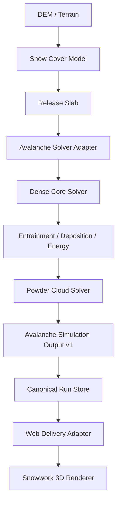
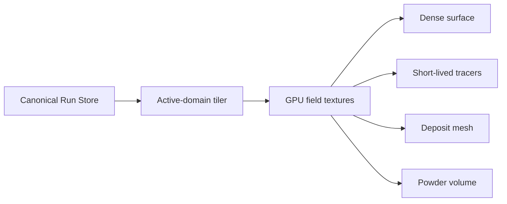

# Snowwork 雪崩物理重构方案

> 目标：将雪的物理状态与视觉表现彻底解耦，形成“真实地形 + 可替换物理求解器 + 雪层演化 + 活动雪崩 + 三维可视化”的数值模拟系统。  
> 本文是实现方案，不包含对现有 Snowwork 或 AvaFrame 的代码修改。

## 1. 重构目标与边界

### 1.1 必须建立的边界

Snowwork 后续只认可一条数据链：

```text
求解器输出物理场 → 统一输出接口 → 渲染适配器 → 三维表现
```

前端允许：

- 对两个求解时刻做时间插值；
- 对网格场做双线性采样；
- 根据流深生成密实雪流表面；
- 在活动网格中生成短寿命示踪雪粒、雪块和雪雾；
- 根据粉雪字段生成云体；
- 根据堆积字段更新静态雪面。

前端禁止：

- 根据 DEM 法向自行计算雪崩主路径；
- 用重力让视觉粒子自由下滑来代替求解器；
- 为视觉效果自行增加或减少雪崩质量；
- 预设雪崩终点或固定路径；
- 在没有粉雪质量/浓度输入时随机生成粉雪云；
- 将全山静态雪层实现为动态粒子池。

### 1.2 第一版求解器策略

第一版不直接自研完整 RAMMS::Extended 等价求解器。推荐：

1. AvaFrame `com1DFA` 作为第一套 Solver Adapter；
2. 先把已有真实物理字段完整、守恒地交给前端；
3. 用统一输出接口隔离 AvaFrame 文件结构；
4. 在接口、质量核算和渲染通过后，再决定是否开发有限体积 Dense Core；
5. OpenFOAM、MPM 或自研求解器只需新增 Adapter，不改 Snowwork 渲染协议。

## 2. 推荐总体架构



求解器与前端之间不得共享求解器内部粒子对象、AvaFrame 特有文件名或 OpenFOAM 特有网格类。

## 3. 物理状态分区

每个网格单元在任一时刻可同时包含静态底层和活动层，但质量必须归入明确的库：

| 质量库 | 变量 | 说明 |
|---|---|---|
| 静态雪层 | `snowCoverMass` | 尚未参与雪崩的可侵蚀雪 |
| 起崩雪板 | `releasedMass` | 从静态雪层转入活动层的初始质量 |
| 密实核心 | `denseMass` | 正在运动的密实雪体 |
| 粉雪云 | `powderMass` | 从密实核心转移的悬浮雪质量 |
| 堆积雪 | `depositedMass` | 已退出活动层的静态质量 |
| 域外流失 | `outflowMass` | 离开计算域的质量 |

全局质量守恒应满足：

$$
M_0 = M_{cover}(t)+M_{dense}(t)+M_{powder}(t)+M_{deposit}(t)+M_{outflow}(t)
$$

若初始质量只统计起崩区和可侵蚀雪层，则每一步必须满足：

$$
\Delta M_{cover}+\Delta M_{dense}+\Delta M_{powder}+\Delta M_{deposit}+\Delta M_{outflow}=0
$$

渲染粒子不进入质量方程。

## 4. 静态 Snow Cover Model

### 4.1 数据结构

推荐建立与求解网格一致的静态字段：

| 字段 | 单位 | 第一阶段 | 未来 |
|---|---:|---|---|
| `dem` | m | 真实 DEM | 更高分辨率/多尺度 |
| `snowDepth` | m | 统一值或分区值 | 实测/遥感/雪模型 |
| `snowDensity` | kg/m³ | 统一值 | 空间变化 |
| `snowTemperature` | K | 常数占位 | 空间场与时间演化 |
| `snowStrength` | Pa | 常数占位 | 稳定性模型 |
| `erodibleDepth` | m | 等于可卷入雪深 | 分层雪被 |
| `forestFraction` | 0–1 | 0 | 林分数据 |
| `obstacleMask` | 0/1 | 0 | 建筑/防护设施 |

第一阶段允许 `snowDepth=0.35 m`、统一密度和统一强度，但必须以栅格字段保存，不能只留在 manifest 的单个标量中。

### 4.2 静态雪层渲染

静态雪层由以下方式之一表现：

- DEM 雪材质 + 雪深导致的轻微几何偏移；
- 静态雪面网格；
- 远近景 LOD 材质。

它不创建数十万个持续更新的 Cesium 粒子。

## 5. Release Slab

### 5.1 规范数据

```json
{
  "id": "JJS-R01",
  "mask": "release_mask",
  "planarAreaM2": 0,
  "surfaceAreaM2": 0,
  "meanDepthM": 1.0,
  "densityKgM3": 200,
  "temperatureK": 263.15,
  "initialMassKg": 0,
  "releaseTimeS": 0.0
}
```

质量按统一口径计算：

$$
M_{release}=\sum_{i\in release} A_{surface,i}\,h_i\,\rho_i
$$

接口同时保留平面面积和坡面面积，避免当前多边形面积与 AvaFrame 栅格化体积不一致。

### 5.2 激活规则

点击触发后：

1. 只从 release mask 对应的静态雪层扣除质量；
2. 同质量加入密实活动层；
3. 未选中的高危区不自动激活；
4. `SECREL` 在 MVP 中关闭；
5. 后续连锁起崩必须使用独立稳定性/冲击判据。

## 6. Dense Avalanche Core

### 6.1 统一状态变量

无论内部使用 AvaFrame 粒子、有限体积网格、OpenFOAM finite-area 还是 MPM，Adapter 必须输出：

- `flowDepth h [m]`
- `velocityX u [m/s]`
- `velocityY v [m/s]`
- `velocityMagnitude [m/s]`
- `density [kg/m³]`
- `massPerArea [kg/m²]`
- `pressure [Pa]`

第一阶段可以令活动密度为常数，但字段仍必须存在。

### 6.2 AvaFrame MVP 映射

| 统一字段 | AvaFrame 来源 | 处理 |
|---|---|---|
| `flowDepth` | `FT` | 直接导出 |
| `velocityX/Y` | `Vx/Vy` | 直接导出；禁止由 DEM 法向替代 |
| `velocityMagnitude` | `FV` | 直接导出并校验 `sqrt(Vx²+Vy²+Vz²)` |
| `density` | 配置 `rho` | 第一阶段展开为字段或元数据常数 |
| `massPerArea` | `FM / surfaceCellArea` | 由 `FM` 与网格面积计算 |
| `pressure` | `P` | 输出时保留 Pa；不要混用峰值 kPa |
| `arrivalTime` | `timeInfo` 或首个湿格时刻 | 输出静态二维场 |

当前 AvaFrame 使用数值粒子并不违反解耦原则；违反原则的是将前端视觉粒子当作运动求解器。

## 7. Entrainment

### 7.1 第一阶段物理

AvaFrame 当前公式可作为 MVP：

$$
\Delta m = \frac{A_p\,\tau_b\,|u|\,\Delta t}{E_{ero}}
$$

同时受可用静态雪质量上限约束。Adapter 必须输出：

- `erosionDepthIncrement(t,y,x)`；
- `erosionDepthCumulative(t,y,x)`；
- `entrainedMassIncrement(t,y,x)`；
- `snowCoverDepthRemaining(t,y,x)`。

质量核算：

$$
\Delta M_{dense}= -\Delta M_{cover}
$$

### 7.2 必须增加的校验

- 单格侵蚀不得超过剩余 `erodibleDepth`；
- 全域卷入质量应与 AvaFrame 质量日志一致；
- `sum(entrainedMassIncrement)` 与活动层质量增量的差值应低于容差；
- 侵蚀后静态雪面应下降，但不能出现负雪深；
- 卷入造成的速度损失应来自求解器，不由前端模拟。

## 8. Deposition

### 8.1 目标定义

堆积是从活动密实层向静态堆积层的守恒转移：

$$
\Delta M_{deposit}=-\Delta M_{dense}
$$

输出至少包括：

- `depositionDepthIncrement`；
- `depositionDepthCumulative`；
- `depositedMassIncrement`；
- `finalDepositionDepth`。

### 8.2 AvaFrame MVP 路径

当前运行只设置了全局动能停止准则，且没有发布空间堆积场。重构时需专门做小型试验比较：

1. `FTStop` 与 `mStop`；
2. `FTDet` 与 `mDet`；
3. `adaptSfcStopped=1`；
4. `adaptSfcDetrainment=1`；
5. 最终低速 `FT` 作为堆积候选的误差；
6. 全局停止时剩余活动质量如何分配到空间堆积格。

在通过守恒试验前，不把“速度低的视觉粒子”称为堆积。

## 9. Random Energy 与 Temperature 接口

第一阶段不实现完整 RKE/热力学，但 schema 必须包含：

- `randomKineticEnergy [J/kg]`，可为全零并标记 `model=placeholder`；
- `temperature [K]` 或 `internalEnergy [J/kg]`；
- `capabilities.randomEnergy=false`；
- `capabilities.temperatureDynamics=false`。

禁止用 AvaFrame 的 `pke` 冒充 RKE。`pke` 是宏观速度对应的峰值动能密度指标，物理含义不同。

## 10. Powder Cloud Layer

### 10.1 数据状态

粉雪层至少输出：

- `powderMassPerArea [kg/m²]`
- `powderVelocityX/Y [m/s]`
- `powderConcentration [kg/m³]` 或质量分数
- `powderHeight [m]`
- `powderSourceMass [kg/m²/s]`
- `powderLifetime [s]`（如模型需要）

### 10.2 第一阶段处理

MVP 不生成粉雪云。接口字段可不存在或为全零，但能力声明必须为 false。

引入粉雪时，顺序为：

1. 先实现单向 Dense → Powder 质量转移；
2. 做密实层减质量、粉雪层增质量的守恒检查；
3. 再加入动量交换；
4. 最后由前端按浓度和高度生成体积云/粒子。

没有物理 `powderConcentration` 时，前端不得随机喷白雾。

## 11. Avalanche Simulation Output Interface v1

### 11.1 设计目标

- 求解器无关；
- 字段有明确单位、网格和时间；
- 支持可选能力；
- 支持完整运行存档与 Web 子集；
- 可检查质量守恒；
- 支持活动区稀疏传输；
- 前端不读取 AvaFrame 原始 ASC 文件。

### 11.2 Canonical Run Store

推荐规范存档：

```text
run-id/
  simulation.json
  grid.json
  terrain.zarr/
  snow-cover.zarr/
  release.zarr/
  dense-core.zarr/
  exchange.zarr/
  energy.zarr/
  powder.zarr/          # 可选
  diagnostics.json
  mass-balance.csv
  provenance.json
```

若当前环境暂不引入 Zarr，可先使用 NetCDF4；两者都应保持 `[time, y, x]` 维度和字段单位。Web 端使用单独 Delivery Adapter 生成分块、压缩的 GPU 纹理，不把浏览器格式当作科学存档格式。

### 11.3 `simulation.json`

```json
{
  "schema": "snowwork.avalanche/v1",
  "runId": "jiangjunshan-r01-...",
  "solver": {
    "name": "AvaFrame-com1DFA",
    "version": "d0451ce+dirty",
    "adapterVersion": "1.0.0"
  },
  "crs": "EPSG:32645",
  "grid": {
    "nx": 0,
    "ny": 0,
    "dxM": 30.0,
    "dyM": 30.0,
    "origin": [0, 0],
    "rowOrder": "north-to-south"
  },
  "time": {
    "unit": "s",
    "values": []
  },
  "capabilities": {
    "denseCore": true,
    "entrainment": true,
    "deposition": false,
    "randomEnergy": false,
    "temperatureDynamics": false,
    "powderCloud": false,
    "forestResistance": false
  }
}
```

`version` 不允许仅写 `dirty`；正式运行需要提交号、工作树补丁哈希和环境锁文件哈希。

### 11.4 必需字段

| 组 | 字段 | 维度 | 单位 |
|---|---|---|---|
| terrain | `dem` | y,x | m |
| snow | `initialSnowDepth` | y,x | m |
| snow | `remainingSnowDepth` | t,y,x | m |
| release | `releaseMask` | y,x | 0/1 |
| core | `flowDepth` | t,y,x | m |
| core | `velocityX/Y` | t,y,x | m/s |
| core | `velocityMagnitude` | t,y,x | m/s |
| core | `density` | t,y,x 或常数 | kg/m³ |
| core | `massPerArea` | t,y,x | kg/m² |
| core | `pressure` | t,y,x | Pa |
| exchange | `erosionDepthCumulative` | t,y,x | m |
| exchange | `depositionDepthCumulative` | t,y,x | m |
| diagnostics | `arrivalTime` | y,x | s |

RKE、温度和粉雪字段为 v1 的可选字段，但字段名、单位和能力标志固定。

### 11.5 质量平衡诊断

每个输出时刻记录：

```text
time_s
static_snow_kg
dense_active_kg
powder_active_kg
deposited_kg
outflow_kg
released_cumulative_kg
entrained_cumulative_kg
mass_residual_kg
relative_residual
```

验收阈值建议：内部单步守恒误差由求解器定义；发布运行的全局相对残差先要求 `< 0.5%`，再逐步收紧。

## 12. Web Delivery Adapter

科学存档与浏览器数据分开：



Delivery Adapter 负责：

- 只传输活动区和其缓冲区；
- 保留原生 30 m 物理网格或可验证的多分辨率；
- 对字段分别量化，并记录 scale/offset/unit/NoData；
- 生成时间索引和空间瓦片索引；
- 不生成雪崩路径；
- 不生成全山视觉粒子文件。

## 13. Snowwork Renderer

### 13.1 静态雪层

- 读取 `initialSnowDepth - erosionDepth + depositionDepth`；
- 使用静态雪材质/网格；
- 未受影响区不更新粒子。

### 13.2 起崩雪板

- 从 `releaseMask` 生成短时雪板网格；
- 裂缝和破碎属于视觉效果；
- 雪板整体位移必须跟随求解器 `flowDepth/Vx/Vy`；
- 雪板质量只来自 release 账本。

### 13.3 密实雪流

- 主体由 `flowDepth` 生成贴地连续表面；
- 表面法向由 `DEM + flowDepth` 计算；
- 颜色/纹理可受速度、密度和深度控制；
- 网格只在 `flowDepth > epsilon` 的活动区生成。

### 13.4 雪块和动态雪粒

它们是短寿命视觉示踪物，不是物理载体：

- 出生位置来自活动单元；
- 初速度严格采样 `Vx/Vy`；
- 生命周期短于或等于两个求解输出间隔；
- 每帧重新采样速度场并限制在活动区；
- 定期重生，禁止长期自由积分形成偏离路径；
- 数量不代表质量，密度只用于视觉采样率。

### 13.5 堆积雪

- 使用 `depositionDepthCumulative` 更新静态堆积网格；
- 不再把“粒子速度低”直接当作堆积；
- 活动层质量转入堆积层后，动态雪体同步减少。

### 13.6 粉雪云

- 只在 `powderConcentration > threshold` 的单元生成；
- 云高来自 `powderHeight`；
- 平移来自 `powderVelocityX/Y`；
- 透明度和粒子密度来自浓度；
- 无粉雪能力时整个模块关闭。

## 14. 推荐代码边界

后续编码时建议在独立目录中建立以下结构，不直接把新模块塞回单体 `pack.py` 或 `app.js`：

```text
snowwork-avalanche/
  contracts/
    avalanche-v1.schema.json
    field-registry.json
  snowcover/
    model.py
    release.py
  solvers/
    base.py
    avaframe_adapter.py
    openfoam_adapter.py
    mpm_adapter.py
  canonical/
    writer.py
    reader.py
    validation.py
    mass_balance.py
  delivery/
    active_domain.py
    field_quantization.py
    web_bundle.py
  web/
    data/simulation-client.js
    renderers/terrain.js
    renderers/static-snow.js
    renderers/release-slab.js
    renderers/dense-core.js
    renderers/tracers.js
    renderers/deposition.js
    renderers/powder-cloud.js
```

现有 `server.py` 只负责运行编排和数据服务；它不计算粒子运动。

## 15. 对现有文件的计划性修改

本节仅列计划，当前不执行。

| 现有文件 | 计划 |
|---|---|
| `scripts/simulate.py` | 显式配置 solver 参数；关闭 MVP 的 SECREL；扩展 AvaFrame 时序输出字段 |
| `scripts/pack.py` | 拆分并最终淘汰；删除 `_build_particles` 与 `snow.bin` |
| `scripts/repack_particles.py` | 删除或归档为旧版实验 |
| `server.py` | 调用 Solver Adapter；返回 schema/capabilities；提供分块字段接口 |
| `web/app.js` | 拆分；删除 downhill/travel/displacement；不再加载 `snow.bin` |
| `tests/test_data.py` | 删除全山粒子断言；新增 schema、方向、质量守恒和堆积测试 |
| `README.md` | 更新为物理场驱动架构，删除全山粒子描述 |

## 16. 最小可运行版本 MVP

### 16.1 功能范围

MVP 必须完成：

1. 真实将军山 30 m DEM；
2. 栅格化静态雪层：深度、密度、温度占位、强度占位；
3. 单一 Release Slab；
4. AvaFrame 驱动的密实雪崩；
5. `FT/Vx/Vy/FV/FM/P` 时序；
6. 卷入深度和卷入质量时序；
7. 可验证的质量平衡；
8. 可用的停止/堆积空间场；
9. 到达时间、峰值速度、峰值流深、影响范围、压力；
10. 静态雪面 + 活动区密实雪流 + 短寿命示踪粒子 + 堆积雪；
11. 求解器与渲染通过 `snowwork.avalanche/v1` 解耦。

MVP 明确不包含：

- 粉雪云；
- RKE 动力学；
- 温度反馈；
- 森林破坏；
- 次级连锁起崩；
- 多求解器在线切换；
- “绝对真实”的参数校准声明。

### 16.2 MVP 验收指标

| 类别 | 验收条件 |
|---|---|
| 路径 | 前端删除所有自定义下坡位移逻辑；方向来自 `Vx/Vy` |
| 地形 | 沟谷汇聚、山脊分流来自求解结果 |
| 卷入 | 静态雪质量减少等于密实层增量（容差内） |
| 堆积 | 自动产生空间堆积图；终态活动质量接近零或明确记录残余 |
| 显示 | 未受影响区无动态粒子；活动区贴地且不漂浮 |
| 指标 | 最大速度、最大流深、质量变化、影响范围、卷雪量、侵蚀深度、堆积深度、到达时间、压力均可查询 |
| 可替换性 | 使用 mock solver 数据时前端无需改代码即可播放 |

## 17. 分阶段执行路线

### 阶段 0：冻结旧版与建立基线

新增/调整模块：

- `contracts/field-registry.json`
- `canonical/validation.py`
- 基线数据清单和哈希

工作：

- 固定当前 AvaFrame 版本和环境；
- 将旧全山粒子方案标记为 legacy；
- 建立 R01 原始输出只读基线；
- 不触碰远程正式工程。

### 阶段 1：统一输出接口

新增/调整模块：

- `contracts/avalanche-v1.schema.json`
- `solvers/base.py`
- `canonical/writer.py`
- `canonical/reader.py`

工作：

- 完成 schema、单位、能力声明和质量账本；
- 用人工小网格构造 contract 测试；
- 前端先用 mock 数据验证接口。

### 阶段 2：AvaFrame Dense Core Adapter

新增/调整模块：

- `solvers/avaframe_adapter.py`
- `simulate.py` 的字段输出配置
- `canonical/mass_balance.py`

工作：

- 导出 `FT/FV/Vx/Vy/FM/P/timeInfo`；
- 禁用 MVP 的 SECREL；
- 记录所有摩擦、密度、时间步和停止参数；
- 检查单位和行列方向。

### 阶段 3：Snow Cover + Entrainment

新增/调整模块：

- `snowcover/model.py`
- `snowcover/release.py`
- `solvers/avaframe_entrainment.py`

工作：

- 将统一 0.35 m 升级为规范雪层栅格；
- 导出/推导侵蚀增量与累计侵蚀；
- 完成静态层—活动层质量守恒测试。

### 阶段 4：Deposition

新增/调整模块：

- `solvers/avaframe_deposition.py`
- `canonical/deposition_validation.py`

工作：

- 试验 `FTStop/mStop/FTDet/mDet/sfcChange`；
- 确认最终堆积的空间定义；
- 确认终止时剩余活动质量处理；
- 输出 Final Deposition Map。

### 阶段 5：前端物理场渲染

新增/调整模块：

- `delivery/active_domain.py`
- `delivery/web_bundle.py`
- `web/data/simulation-client.js`
- `web/renderers/static-snow.js`
- `web/renderers/dense-core.js`
- `web/renderers/tracers.js`
- `web/renderers/deposition.js`

工作：

- 删除 `snow.bin`；
- 未受影响区域只显示静态雪层；
- 密实主体由 `flowDepth` 建网格；
- 示踪粒子读取 `Vx/Vy`，短寿命、无物理权力；
- 堆积由 deposition 字段更新。

### 阶段 6：Powder Cloud

新增模块：

- `physics/powder/`
- `solvers/openfoam_powder_adapter.py` 或独立粉雪求解器
- `web/renderers/powder-cloud.js`

先做守恒的 Dense → Powder 转移，再做视觉云。

### 阶段 7：Random Energy

新增模块：

- `physics/rke.py`
- `canonical/energy_validation.py`

RKE 必须是独立守恒变量，不能由渲染噪声代替。

### 阶段 8：Temperature / Internal Energy

新增模块：

- `physics/energy.py`
- `physics/phase_change.py`

加入摩擦热、卷入混合、RKE 耗散和温度—摩擦耦合。

### 阶段 9：Forest / Obstacles

新增模块：

- `physics/forest.py`
- `physics/obstacles.py`
- `snowcover/landcover.py`

先实现阻力栅格，再考虑树木破坏和动量交换。

### 阶段 10：参数校准与验证

新增模块：

- `calibration/cases/`
- `calibration/objectives.py`
- `validation/benchmark_suite.py`

使用有观测范围、堆积和到达时间的公开案例校准；将军山在缺少真实事件观测时只能做情景模拟，不得标为预报产品。

## 18. 第一轮编码任务建议

在用户确认本方案后，第一轮只做“接口与只读 Adapter 原型”，不立刻重写求解器和渲染器：

1. 新建 `snowwork.avalanche/v1` schema；
2. 写 AvaFrame 输出字段盘点测试；
3. 用已有 R01 原始运行导出一份 canonical 数据集；
4. 验证 `FT/FV/Vx/Vy/FM/P` 的单位、方向和时间对齐；
5. 生成质量平衡报告；
6. 不修改现有 8765 页面；
7. canonical 数据验收后，再开始前端替换。

这样可以先证明“物理链路完整”，避免再次用视觉效果掩盖字段缺失。

## 19. 关键决策清单

进入编码前需要确认：

1. MVP 使用 AvaFrame `com1DFA` 作为首个物理求解器；
2. MVP 关闭自动 `SECREL`；
3. 统一输出接口采用 Zarr 或 NetCDF4 作为科学存档；
4. 浏览器使用活动区分块字段，不复用 `snow.bin`；
5. 当前摩擦模型是显式固定 SamosAT、Voellmy，还是同时做两套对照；
6. 堆积采用 AvaFrame 停止/表面适配能力，还是在 Adapter 中增加守恒终态处理；
7. 首轮只在旧页面旁新建 V2，不覆盖当前可回放原型。

推荐默认选择：AvaFrame + 关闭 SECREL + Zarr canonical store + 活动区 Web bundle + 显式 Voellmy/SamosAT 对照 + 独立 V2 页面。

## 20. 依据

- 《当前雪崩模拟实现检查报告》中的本地源码证据。
- `RAMMS_Extended_公开实现原理拆解.md`：公开 RAMMS 方程、AvaFrame/OpenFOAM 对照与开放求解器路线。
- AvaFrame 本地源码 `D:\AvaFrame_demo\avaframe\com1DFA`：字段、摩擦、卷入、停止和导出实现。
- 当前 Snowwork 本地独立原型 `projects/avalanche-dynamic-lab`。

