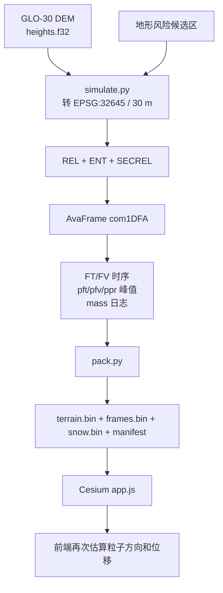

# 当前雪崩模拟实现检查报告

> 检查对象：Snowwork 本地独立原型 `projects/avalanche-dynamic-lab` 与本地 AvaFrame 源码 `D:\AvaFrame_demo`  
> 检查日期：2026-11-17  
> 检查方式：只读源码、配置、已发布场景和既有计算输出；本轮未修改 Snowwork、AvaFrame、场景数据或远程仓库。

## 1. 结论摘要

当前系统不是完全脱离物理的粒子动画：后端已经运行 AvaFrame `com1DFA`，并得到真实 DEM 上的流深 `FT`、速度大小 `FV`、峰值流深/速度、峰值压力和质量日志。

但当前渲染仍存在决定性的二次运动逻辑：前端没有读取 AvaFrame 的二维速度分量 `Vx/Vy`，而是在 GPU 着色器中根据 DEM 法向估算下坡方向，再用固定经验位移推动覆盖全山的粒子。因此：

- 雪崩影响范围和粒子“何时启动”受到 AvaFrame 场控制；
- 粒子具体向哪里移动、移动多远，却由前端经验动画决定；
- 粒子的运动轨迹不是求解器轨迹；
- 粒子渲染与密实流物理场只做了弱耦合；
- 当前结果不能满足“物理模型决定雪崩怎么运动，粒子只负责表现”的新标准。

另外，当前版本将整个将军山显示域打包为 677,210 个雪粒子，与“未发生雪崩区域使用静态雪层”冲突。当前系统需要停止沿用 `snow.bin + Whole-terrain snow cloud` 方案。

## 2. 本次检查范围与版本边界

### 2.1 Snowwork 当前检查对象

本报告以本地独立目录为当前实现：

```text
D:\WHU-class source\跟组学习\20261115雪崩\projects\avalanche-dynamic-lab
```

该目录包含：

- `scripts/simulate.py`：准备将军山 AvaFrame 输入并运行 `com1DFA`；
- `scripts/pack.py`：将 AvaFrame ASC 时序压缩为浏览器二进制；
- `server.py`：本地任务 API 与静态资源服务；
- `web/app.js`：Cesium 地形、雪体和粒子渲染；
- `data/source/jiangjunshan/`：将军山 DEM 与冬季影像；
- `data/public/jiangjunshan_r01/`：当前发布的 R01 场景。

该独立目录在当前工作树中仍属于未跟踪目录，尚不能视为已经同步到远程分支的正式版本。

### 2.2 AvaFrame 当前检查对象

```text
D:\AvaFrame_demo\avaframe\com1DFA
```

本地源码版本文件为 `d0451ce+dirty`。由于工作副本带 `dirty` 标记，后续正式开发前应固定完整提交号、差异补丁和环境锁文件，避免“同名 AvaFrame、不同物理实现”。

## 3. 当前数据与执行链路



物理求解与渲染之间目前缺少独立、版本化、求解器无关的 Simulation Output Interface。`pack.py` 同时承担物理字段选择、空间降采样、二进制编码和粒子生成，职责过多。

## 4. 编码前九项检查结果

### 4.1 当前雪崩运动由什么代码控制

存在两套运动逻辑。

第一套是 AvaFrame 物理运动：

- `scripts/simulate.py:154-200` 调用 `com1DFA.com1DFAMain`；
- AvaFrame `DFAfunctionsCython.pyx:273-331` 计算切向重力、法向应力和摩擦；
- `DFAfunctionsCython.pyx:867-966` 更新粒子速度与位置，并将位置/速度重新投影到 DEM；
- `DFAfunctionsCython.pyx:1223-1425` 将求解粒子汇总为 `FT/FV/FM/Vx/Vy/Vz/P` 等网格场。

第二套是前端视觉运动：

- `web/app.js:323-325` 使用 `-normal.xy` 估算下坡方向；
- `web/app.js:328-332` 按经验函数计算 8–42 m 的位移，并叠加横坡扰动；
- `web/app.js:333-335` 只在局部切平面上修正高程；
- `web/app.js:337-366` 决定粒子层内位置、尺寸、透明度和拉伸方向。

结论：宏观影响区来自 AvaFrame，具体可视粒子轨迹由前端控制。当前实现没有达到严格解耦要求。

### 4.2 当前粒子是否直接决定运动路径

需要区分物理粒子和视觉粒子：

- AvaFrame 内部粒子是 `com1DFA` 的数值载体，参与物理计算；
- `snow.bin` 中的 Cesium 粒子不是 AvaFrame 求解粒子，是 `pack.py` 重新生成的视觉粒子；
- Cesium 粒子不反馈到物理求解器，但其显示路径由前端着色器自行决定；
- 前端粒子因此直接决定“用户看见的运动路径”，虽然不决定 AvaFrame 结果。

需要删除的是视觉粒子的路径决定权，不是简单禁止 AvaFrame 使用其内部数值粒子。

### 4.3 DEM 数据存储方式

当前存在三层 DEM 表达：

| 层 | 文件/结构 | CRS/分辨率 | 用途 |
|---|---|---|---|
| 原始源数据 | `data/source/jiangjunshan/heights.f32` + `terrain.json` | 经纬度 1 arc-second；684×540 | 将军山源高程 |
| 求解器 DEM | `Inputs/DEM_JJS_Topo.asc` | EPSG:32645；30 m | AvaFrame 计算 |
| 浏览器 DEM | `terrain.bin` | 本地 ENU 相对坐标；显示步长 2，即约 60 m | Cesium 网格 |

`scripts/jiangjunshan.py` 使用双线性重采样将源 DEM 转为 30 m UTM 网格。浏览器端又按 `displayStride=2` 降为 60 m，这会降低沟谷、山脊和流动边界的视觉精度。

### 4.4 当前雪层数据结构

当前没有完整 Snow Cover Model。

已有内容：

- `ENT/whole-mountain-snowpack.shp`：几乎覆盖整个求解域；
- 单一可侵蚀深度：0.35 m；
- AvaFrame 全局活动雪密度 `rho=200 kg/m³`；
- AvaFrame 全局卷入雪密度 `rhoEnt=100 kg/m³`；
- `manifest.snowpack` 只记录 `entrainableDepthM` 和文本状态。

缺失内容：

- 每格静态雪厚 `Hs(x,y)` 的规范化持久层；
- 每格雪密度 `rho_s(x,y)`；
- 雪温 `T_s(x,y)`；
- 抗剪强度 `tau_c(x,y)`；
- 可侵蚀剩余量随时间的公开时序；
- 森林、障碍物和雪面状态场；
- 初始雪层、侵蚀后雪层、堆积后雪层之间的守恒账本。

### 4.5 当前 AvaFrame 输出内容

当前 Snowwork 配置为：

```ini
resType = pft|pfv|ppr|FT|FV
tSteps = 0:2
```

因此发布链路实际使用：

| 输出 | 当前状态 | 说明 |
|---|---|---|
| `FT(t)` | 已导出 | 流深/流厚，m |
| `FV(t)` | 已导出 | 速度大小，m/s |
| `pft` | 已导出 | 峰值流深 |
| `pfv` | 已导出 | 峰值速度 |
| `ppr` | 已导出 | 峰值压力；AvaFrame 按 `rho*v²` 计算 |
| 质量日志 | 已导出 | current、entrained、detrained、stopped、initialized |
| `Vx/Vy/Vz(t)` | AvaFrame 已计算，Snowwork 未导出 | 这是当前最关键缺口 |
| `FM(t)` | AvaFrame 已计算，Snowwork 未导出 | 网格活动质量 |
| `P(t)` | AvaFrame 可计算，Snowwork 未导出 | 时变压力 |
| `FTEnt(t)` | AvaFrame 已计算，Snowwork 未导出 | 卷入造成的雪厚变化 |
| `FTStop(t)` | AvaFrame 已计算，Snowwork 未导出 | 停止质量对应厚度 |
| `FTDet(t)` | AvaFrame 已计算，Snowwork 未导出 | 脱离/转移厚度 |
| `sfcChange` | AvaFrame 支持，Snowwork 未导出 | 累积表面变化需相应配置 |
| `timeInfo` | AvaFrame 支持，Snowwork 未导出 | 到达时间 |
| RKE | 未实现 | `pke` 是宏观动能峰值，不是 RAMMS RKE |
| Temperature | 当前未启用 | AvaFrame 有 `wetSnow`/焓思路，但当前运行不是该模型 |
| Powder cloud | 未实现 | 当前白色粒子不是粉雪求解结果 |

### 4.6 当前前后端接口

HTTP 接口只有：

- `GET /api/scenarios`
- `GET /api/status`
- `GET /api/zones`
- `GET /api/jobs/{id}`
- `POST /api/run`

场景文件接口为：

- `manifest.json`
- `terrain.bin`
- `frames.bin`
- `snow.bin`
- `albedo.webp`

当前 `frames.bin` 每格只有 4 字节：两字节量化流深、两字节量化速度大小。它没有：

- 速度方向；
- 质量/密度；
- 侵蚀与堆积；
- 时变压力；
- RKE/温度；
- 粉雪字段；
- 单位和字段级 NoData；
- schema 版本与能力声明。

当前接口绑定 AvaFrame 的字段选择和当前渲染做法，不能直接无痛替换为 OpenFOAM、MPM 或自研求解器。

### 4.7 当前可以直接复用的模块

| 模块 | 复用判断 | 备注 |
|---|---|---|
| DEM 读取与 UTM 重采样 | 可直接复用 | 需增加统一 grid 元数据和坡面面积 |
| 地形风险候选区生成 | 可复用作起崩区候选 | 目前仅地形易发性，不是实时稳定性预测 |
| REL 起崩多边形生成 | 可复用 | 应补充 release 元数据与质量核算 |
| ENT 雪层输入 | 可作为均匀雪层 MVP | 后续升级为空间栅格场 |
| AvaFrame 任务启动/日志 | 可复用 | 需包进 Solver Adapter |
| AvaFrame 密实流计算 | 可作为第一阶段物理基线 | 当前使用 SamosAT，不是 Voellmy |
| Cesium 地形网格与相机 | 可复用 | 与动态雪渲染拆开 |
| 时间轴、场景列表、任务轮询 | 可复用 | 改为读取统一接口 |
| `FieldMesh` 的字段纹理思想 | 可复用 | 改成多字段、带 schema 的纹理适配器 |

### 4.8 需要删除、替换或重构的模块

| 当前位置 | 处理 | 原因 |
|---|---|---|
| `pack.py:_build_particles` | 删除 | 生成覆盖全山的视觉粒子池 |
| `pack.py` 写出 `snow.bin` | 删除 | 静态雪层不应是动态粒子文件 |
| `app.js:Whole-terrain snow cloud` | 删除 | 与新总体原则直接冲突 |
| `app.js` 的 `downhill/travel/displacement` | 删除 | 前端自行决定路径和位移 |
| `frames.bin` 固定 RGBA 深度/速度编码 | 替换 | 字段不足且无 schema 版本 |
| `pack.py` 单体职责 | 拆分 | 求解器适配、规范化、Web 打包应分离 |
| `simulate.py` 强制七个 `SECREL` | MVP 暂停 | 新 MVP 先保证单一 Release Slab + 卷雪；连锁释放后续独立设计 |
| 前端粒子开关“雪山雪粒子” | 重构 | 改为活动区雪块/示踪粒子/粉雪云开关 |

### 4.9 当前渲染与物理计算耦合程度

| 内容 | 耦合程度 | 评价 |
|---|---|---|
| 影响区出现时间 | 中 | 依赖 `FT` 到达时间 |
| 密实流流深 | 中 | 读取 `FT`，但视觉主体已改为粒子云 |
| 速度大小与颜色 | 中 | 读取 `FV` |
| 运动方向 | 低 | 前端用 DEM 法向估算，不读取 `Vx/Vy` |
| 位移距离 | 低 | 前端固定经验位移，不是速度积分结果 |
| 质量增长 | 低 | 只显示汇总值，不驱动体积守恒渲染 |
| 侵蚀 | 无 | 没有侵蚀场渲染，静态雪层不减少 |
| 堆积 | 低 | “速度低即沉积”的视觉状态，不是沉积场 |
| 压力 | 无 | 只存在峰值文件，前端未读取 |
| 粉雪云 | 无 | 没有物理粉雪层 |

总体判断：物理场控制“何处有雪崩”，前端经验动画控制“看起来如何移动”。这是本次重构必须切断的错误边界。

## 5. 当前物理配置事实

当前 R01 发布场景对应 `JJS-R01_36a9b51c77_com1_C_L_ent_dfa`，主要配置为：

| 参数 | 当前值 |
|---|---:|
| 求解网格 | 30 m |
| 保存间隔 | 约 2 s |
| 计算步长 | 0.1 s |
| 活动雪密度 | 200 kg/m³ |
| 卷入雪密度 | 100 kg/m³ |
| 起崩厚度 | 1.0 m |
| 可侵蚀雪深 | 0.35 m |
| 摩擦模型 | `samosAT` |
| 卷入模型 | 基于底部剪切功率与 `entEroEnergy=5000` |
| 停止准则 | 总动能低于峰值的 1% |
| 表面随停止更新 | 关闭 (`adaptSfcStopped=0`) |
| 表面随卷入更新 | 关闭 (`adaptSfcEntrainment=0`) |
| 可侵蚀沉积 | 关闭 |

需要特别纠正两点：

1. 当前运行不是 Voellmy。`samosATAuto` 根据释放体积选择了 `samosAT`。
2. 当前“deposition”没有形成可发布的最终堆积场。质量日志中的 `stopped` 主要是结束准则层面的停止质量，现有打包器没有输出空间堆积深度；当前最后一帧局部最大速度仍约 7.39 m/s，也不适合作为已完全静止的堆积结果。

## 6. 当前场景数据质量问题

### 6.1 全山粒子与文档不一致

- 当前 manifest：677,210 粒子；
- 当前 `snow.bin`：约 35.2 MB；
- 当前 README 仍写 424,566 粒子；
- 当前测试明确要求“每个显示网格固定粒子数”，说明全山粒子是被测试固化的现有行为。

后续重构必须同步删除或重写这些测试，避免旧方案继续被自动测试保护。

### 6.2 起崩质量口径未统一

风险候选区记录的平面面积约 174,963.9 m²，而 AvaFrame 日志使用 30 m 网格和坡面面积计算的释放体积约 202,263.53 m³。当前 manifest 只给出初始总质量，没有清晰记录：

- 使用平面面积还是坡面面积；
- 多边形栅格化规则；
- 边界格占比；
- 初始质量是否包含任何初始化修正。

新接口必须同时记录 `planarArea`、`surfaceArea`、`releaseVolume`、`density` 和 `initialMass`，并提供质量校验误差。

### 6.3 次级释放没有形成受控业务语义

当前 `simulate.py` 自动把其余七个候选区写入 `SECREL`。AvaFrame 的触发条件是活动流厚与次级区域相交，而不是雪体强度、冲击阈值或稳定性演化。当前已发布运行中也没有发现次级区实际释放日志。

因此它既没有实现目标中的物理连锁起崩，也会增加 MVP 质量口径复杂性。建议第一版关闭，后续以独立模块重新引入。

## 7. 当前 AvaFrame 可利用的物理能力

AvaFrame 当前源码已经具备大量 Snowwork 尚未利用的字段：

- 地形切向重力与曲率项；
- SamosAT、Coulomb、Voellmy、空间 Voellmy 等摩擦；
- SPH 压力梯度/粒子间作用；
- `FT/FV/FM/Vx/Vy/Vz`；
- 基于剪切和侵蚀能的卷入；
- 卷入引起的质量增加与速度损失；
- 阻力区域与可选 detrainment；
- 粒子停止与表面适配接口；
- `P/ppr`、`FTEnt/FTStop/FTDet`、`sfcChange/timeInfo`；
- 质量平衡日志。

但以下能力不能宣称已完成：

- RAMMS 式 RKE；
- 完整温度/内能守恒；
- 空间雪温和抗剪强度场；
- 物理粉雪云；
- 核—粉雪质量动量交换；
- 经真实案例校准的将军山参数；
- 完整守恒的最终堆积产品。

## 8. 风险分级与立即决策

| 级别 | 问题 | 决策 |
|---|---|---|
| P0 | 前端自行决定粒子方向/位移 | 必须删除 |
| P0 | 全山动态粒子 | 必须删除 |
| P0 | 无求解器无关输出接口 | 先设计接口再改渲染 |
| P0 | 未导出 `Vx/Vy/FM/侵蚀/堆积` | AvaFrame Adapter 首批补齐 |
| P0 | 最终堆积场不可用 | 单独验证停止/沉积配置与质量守恒 |
| P1 | 当前摩擦为 SamosAT 且未校准 | 显式配置并记录参数来源 |
| P1 | 静态雪层仅有统一深度 | 建立 Snow Cover 数据结构 |
| P1 | 次级释放语义不可靠 | MVP 关闭，后续再做 |
| P2 | 60 m 前端显示网格过粗 | 活动区按 30 m 或自适应瓦片输出 |
| P2 | README、测试和 manifest 不一致 | 重构时同步更新 |

## 9. 验收结论

当前系统可以保留为“已有 AvaFrame 结果回放原型”，不能继续作为目标数值雪崩系统的渲染基础。

重构起点应是：

1. 保留 DEM、起崩区、AvaFrame 运行和 Cesium 地形；
2. 停止打包/加载 `snow.bin`；
3. 建立统一 Simulation Output Interface；
4. 从 AvaFrame 导出真实二维速度、质量、侵蚀和停止/堆积字段；
5. 让前端只读取字段，不再生成雪崩路径；
6. 静态雪场与活动雪崩分开渲染。

## 10. 源码证据索引

### Snowwork

- `projects/avalanche-dynamic-lab/scripts/simulate.py:88-140`：DEM、REL、全域 ENT、SECREL 准备。
- `projects/avalanche-dynamic-lab/scripts/simulate.py:181-200`：AvaFrame 配置与运行。
- `projects/avalanche-dynamic-lab/scripts/pack.py:86-160`：全山视觉粒子生成。
- `projects/avalanche-dynamic-lab/scripts/pack.py:163-267`：读取 FT/FV、60 m 降采样、写出 frames/snow。
- `projects/avalanche-dynamic-lab/web/app.js:281-387`：全山粒子着色器和前端运动。
- `projects/avalanche-dynamic-lab/web/app.js:614-651`：场景接口与 `snow.bin` 加载。
- `projects/avalanche-dynamic-lab/tests/test_data.py:90-150`：全山粒子方案被当前测试固化。

### AvaFrame

- `D:\AvaFrame_demo\avaframe\com1DFA\DFAfunctionsCython.pyx:176-331`：地形力、法向应力和摩擦。
- `D:\AvaFrame_demo\avaframe\com1DFA\DFAfunctionsCython.pyx:392-484`：卷入、动量稀释和可侵蚀质量扣减。
- `D:\AvaFrame_demo\avaframe\com1DFA\DFAfunctionsCython.pyx:489-543`：卷入公式。
- `D:\AvaFrame_demo\avaframe\com1DFA\DFAfunctionsCython.pyx:695-1126`：速度、位置、停止和质量账本。
- `D:\AvaFrame_demo\avaframe\com1DFA\DFAfunctionsCython.pyx:1223-1425`：网格场 `FM/FV/Vx/Vy/Vz/FT/P/FTEnt/FTStop/FTDet`。
- `D:\AvaFrame_demo\avaframe\com1DFA\com1DFA.py:1760-1830`：字段初始化。
- `D:\AvaFrame_demo\avaframe\com1DFA\com1DFA.py:3165-3248`：时序字段导出。
- `D:\AvaFrame_demo\avaframe\com1DFA\com1DFA.py:2879-2940`：次级释放触发逻辑。

